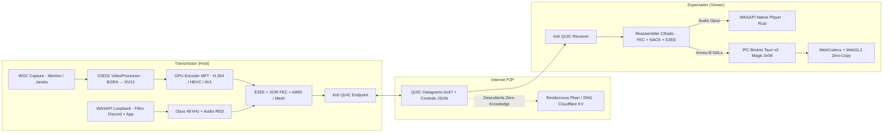

<div align="center">
  

  <h1>Luke-Share</h1>

  <p>
    <strong>Compartilhamento de tela P2P de ultra-baixa latência para jogos e chamadas no Discord</strong><br />
    Direto pela internet sobre <strong>QUIC / TLS 1.3</strong> — sem VPN, sem servidores centrais, GPU Zero-Copy até 240 FPS e remoção automática do eco do Discord.
  </p>

  <p>
    <a href="https://github.com/Lucaspch/Luke-share-/releases/latest">
      
    </a>
    
    
    
    
  </p>

  <p>
    <strong><a href="https://github.com/Lucaspch/Luke-share-/releases/latest">Baixar Instalador (.exe)</a></strong>
    &nbsp;·&nbsp;
    <a href="#por-que-usar-o-luke-share">Diferenciais</a>
    &nbsp;·&nbsp;
    <a href="#instalação-rápida">Instalação</a>
    &nbsp;·&nbsp;
    <a href="#como-usar">Como Usar</a>
    &nbsp;·&nbsp;
    <a href="#presets-e-codecs-de-vídeo">Presets</a>
    &nbsp;·&nbsp;
    <a href="#arquitetura-técnica">Arquitetura</a>
    &nbsp;·&nbsp;
    <a href="#para-desenvolvedores">Desenvolvedores</a>
  </p>
</div>

---

## Por que usar o Luke-Share?

Compartilhar gameplay ou tela com amigos costuma significar escolher entre **qualidade travada/paga** ou **gambiarras de VPN com eco na call**. O **Luke-Share** resolve os dois problemas em um único executável nativo para Windows:

| Recurso | Luke-Share | Discord (Gratuito) | VPNs (Hamachi / Radmin) |
| :--- | :--- | :--- | :--- |
| **Qualidade & FPS** | **Até Resolução Nativa & 240 FPS** (ou Destravado) | Limitado a 720p / 30 FPS (Nitro pago para 1080p+) | Depende de outro app de streaming |
| **Eco do Discord** | **Removido automaticamente** via WASAPI | Nativo na própria call | Precisa roteamento virtual complexo |
| **Grupos & Salas** | **Grupos persistentes sem call de voz + Webcam P2P** | Obrigatório entrar em canal de voz junto | Não possui |
| **Privado (1:1)** | Código curto `LK-XXXX-XXXX` ou **Amigos (`LK#TAG`)** | DM direta no servidor deles | Copiar IP virtual toda sessão |
| **Rede & Conexão** | **P2P QUIC direto na Internet** (Zero VPN) | Passa por servidores centrais | Exige VPN instalada em todos os PCs |
| **Privacidade** | **E2EE Zero-Trust** + assinaturas Ed25519 | Processado em nuvem | Tráfego exposto na malha virtual |
| **Custo** | **100% Gratuito & Open Source** | Paywall para alta fidelidade | Limites de sala gratuita |

---

## Principais Recursos

### Vídeo Zero-Copy na GPU & WebGL2
- **Pipeline direta na VRAM:** Captura por hardware via `Windows.Graphics.Capture` (WGC), escala e conversão `BGRA → NV12 (BT.709)` no `ID3D11VideoProcessor` e codificação por GPU (**NVENC / QuickSync / AMF**) sem passar quadros brutos pela CPU.
- **IPC Binário + WebGL2:** Os quadros codificados cruzam do backend Rust ao frontend pelo protocolo binário `0x56` (zero Base64) direto para o `VideoDecoder` (**WebCodecs**) e são apresentados em GPU via **WebGL2** com latência sub-1ms.
- **Troca de Fonte Contínua (*Seamless Switch*):** Alterne de monitor para janela de jogo (ou ajuste resolução/FPS) no meio da call sem desconectar os espectadores.

### Áudio Zero-Eco no Discord
- **Dois modos de captura inteligente (WASAPI Loopback):**
  - **Apenas este aplicativo:** Isola exclusivamente a árvore de processos do jogo/janela selecionada.
  - **Sistema inteiro (sem Discord):** Captura o áudio do Windows excluindo dinamicamente `discord.exe`, `discordptb.exe`, `discordcanary.exe` e o próprio Luke-Share — mesmo se o Discord abrir depois ou se você estiver assistindo à live de outro amigo ao mesmo tempo.
- **Reprodução Nativa em Rust:** O som chega em **Opus Stereo 48 kHz** e é reproduzido diretamente no backend nativo em alta prioridade, sem engasgos mesmo com a janela minimizada.
- **Audio RED (RFC 2198) + Opus PLC:** Carrega redundância do frame anterior em cada pacote de áudio para neutralizar perdas de rede sem aumentar latência.

### Transporte Resiliente & Controle Inteligente de Rede
- **Zero-RTT XOR FEC Dinâmico:** Gera blocos de paridade adaptativos (reforçados em **25%–50%** nos *Keyframes* e em conexões instáveis) no domínio cifrado, recuperando pacotes perdidos antes mesmo de precisar retransmitir.
- **BWE Warm-up & NACK/PLI Adaptativos:** Sonda inicial suave (`70% → 100%` nos primeiros ~2s) e timeouts calibrados em tempo real pelo RTT do QUIC.
- **Isolamento por Espectador + Mesh Cascade:** Se apenas um amigo na sala estiver com Wi-Fi instável, ele recebe FEC extra sem derrubar a qualidade dos demais. Com **3 ou mais espectadores**, pares saudáveis retransmitem pacotes assinados em cascata para aliviar o upload do Host.
- **Auto-Heal Transparente:** Em oscilações momentâneas de rede, o receptor reconecta automaticamente em segundo plano por até **15 segundos** mantendo a sala intacta.

### Grupos Persistentes (Sem Voz) & Privado (`v1.0.0`)
- **Grupos no estilo Discord (Zero Voz):** Crie ou entre em servidores de grupo com múltiplas salas (`# Geral` ou salas personalizadas). Ao entrar em uma sala, você assiste automaticamente quem já estiver transmitindo e pode ligar sua tela/webcam a qualquer momento — tudo sem criar uma call de voz em paralelo ao seu Discord.
- **Convites Híbridos P2P:** Compartilhe códigos curtos de grupo (`LKG-XXXX-XXXX`), tickets persistentes (`lkg-...`) ou envie convites em 1 clique para amigos online via P2P Mesh sincronizado por assinaturas Ed25519.
- **Modo Privado Preservado:** Clique no ícone **Privado** no topo da barra lateral para compartilhar/assistir com acesso restrito usando códigos curtos (`LK-XXXX-XXXX`), tickets diretos (`lk-...`) ou o protocolo **Pedir para Entrar (*Knock P2P*)** na lista de Amigos.

### Webcam P2P Nativa (Dual-Track)
- **Captura Windows Media Foundation:** Enumeração e captura nativa de webcams sem depender de permissão de navegador, enviando apenas vídeo (zero microfone) pela mesma pipeline D3D11 + Encoder GPU + WebCodecs/WebGL2.
- **Tela + Câmera Simultâneos:** Compartilhe sua tela e sua webcam como streams independentes na grade (com prévia local espelhável), tanto dentro de Grupos quanto no modo Privado.

### Social P2P & Privacidade
- **Identidade Permanente (`LK#TAG`):** Par de chaves **Ed25519** gerado localmente no seu PC — suas solicitações de amizade são assinadas criptograficamente sem conta, e-mail ou login.
- **Protocolo *Knock* ("Pedir para Entrar"):** Veja quais amigos estão ao vivo e clique para assistir; o anfitrião recebe um aviso instantâneo para **Permitir** ou **Recusar**.
- **Códigos Curtos Blindados (`LK-XXXX-XXXX`):** Protegidos ponta-a-ponta com derivação **HKDF-SHA256** e criptografia **AES-256-GCM** (*Zero-Knowledge*).

### Palco Multi-Stream & Auto-Update
- Assista **múltiplas transmissões simultâneas em grade** enquanto também compartilha sua própria tela.
- Controles individuais por tela: volume, mudo, **Foco** (duplo clique), **Picture-in-Picture (PiP)**, **Mini-Player flutuante sempre no topo** e **Tela Cheia**.
- **Auto-Updater Integrado:** Verificação e atualização com 1 clique via GitHub Releases validadas por assinatura digital **Minisign**.

---

## Instalação Rápida

> [!NOTE]
> **Requisitos:** Windows 10 (versão 1903 ou superior) ou Windows 11 (64 bits), além de placa de vídeo com suporte a Direct3D 11 (NVIDIA, AMD ou Intel). O WebView2 já vem integrado às versões atuais do Windows.

Escolha o formato de sua preferência nos [**Releases do GitHub**](https://github.com/Lucaspch/Luke-share-/releases/latest):

| Formato | Arquivo | Indicado para |
| :--- | :--- | :--- |
| **Instalador Oficial** *(Recomendado)* | `Luke-Share_<versao>_x64-setup.exe` | Instalação padrão no Windows com **atualização automática** integrada. |
| **Pacote Portátil** | `Luke-Share-v<versao>-Windows.zip` | Extrair em qualquer pasta e abrir `Luke-Share.exe` sem instalar nada. |

<details>
<summary>Sobre o aviso do Windows SmartScreen na primeira execução</summary>

Como o projeto ainda não utiliza certificado pago de assinatura EV comercial, o Windows Defender SmartScreen pode exibir um alerta na primeira abertura. Clique em **Mais informações → Executar assim mesmo**. Todas as atualizações internas do app são verificadas criptograficamente com a chave pública **Minisign** embarcada no binário.

</details>

---

## Como Usar

### 1. Modo Privado (Código ou Amigos — Knock P2P)
1. Garanta que o botão **Privado** esteja selecionado no topo da barra lateral esquerda.
2. Escolha entre **Monitores** ou **Aplicativos** no estúdio inicial, ajuste Codec, Resolução, FPS, Bitrate e modo de áudio e clique em **Iniciar Transmissão**.
3. Envie o código curto (`LK-XXXX-XXXX`) para seu amigo — ou espere seus amigos clicarem em **Assistir** para aceitar o pedido na tela (*Knock P2P*).
4. Para assistir no Privado, cole qualquer código `LK-XXXX-XXXX` ou ticket `lk-...` na barra superior e clique em **Entrar**.

### 2. Modo Grupos (Estilo Discord, Sem Voz) & Webcam
1. Clique no botão **`+`** na barra lateral esquerda para **Criar um grupo** ou **Entrar com código** (`LKG-XXXX-XXXX` / ticket `lkg-...`).
2. Clique em uma sala (como **`# Geral`** ou crie novas salas como `# Jogos` ou `# Cine`). Quem entrar depois assiste automaticamente todas as telas e webcams ativas naquela sala.
3. Use os botões da barra inferior para ligar/trocar o compartilhamento de **Tela** ou ativar sua **Webcam** (apenas vídeo, sem microfone).
4. Para voltar às transmissões privadas por código/pedido, clique no ícone **Privado** no topo esquerdo.

### Controles no Palco Multi-Stream

| Ação / Controle | O que faz |
| :--- | :--- |
| **Duplo clique** no vídeo *(ou botão Expandir)* | Alterna entre **Modo Foco** e **Grade** |
| **Ícone de Alto-Falante + Slider** na tile | Ajusta ou muta o volume individual daquele amigo |
| **Picture-in-Picture** no card | Abre o stream em janela flutuante do sistema |
| **Mini-Player** na barra inferior | Compacta o app em janela flutuante **Sempre no Topo** |
| **Compartilhar Tela** na dock inferior | Inicia ou troca sua captura sem sair das lives que está vendo |

---

## Presets e Codecs de Vídeo

Os perfis foram calibrados em [`resolution.rs`](src-tauri/src/video/resolution.rs) e [`encoder.rs`](src-tauri/src/video/encoder.rs) para manter proporção exata (sem cortes em monitores Ultrawide 21:9, 2K 2560×1440 ou 4K e **sem upscale** artificial):

| Preset | Resolução Máxima | Bitrate Padrão (1 viewer) | Indicação |
| :--- | :--- | :--- | :--- |
| **Nativa (Origem)** | Resolução original par | `18 Mbps` | Textos finos, leitura de código e monitores 1440p/4K |
| **1080p** *(Recomendado)* | `1920 × 1080` | `14 Mbps` | Melhor equilíbrio entre nitidez e fluidez em jogos |
| **720p** | `1280 × 720` | `8 Mbps` | Conexões com upload moderado ou vários espectadores |
| **480p** | `854 × 480` | `3,5 Mbps` | Modo econômico de baixíssimo consumo |

> [!TIP]
> **Qual codec escolher?**
> - **Auto / H.264 (AVC):** Padrão recomendado — máxima compatibilidade de decodificação por hardware e menor latência ponta-a-ponta.
> - **HEVC (H.265):** Maior nitidez por megabit quando ambas as GPUs suportam decodificação por hardware.
> - **AV1:** Máxima eficiência de compressão para placas modernas (RTX 40 / RX 7000 / Intel Arc+).

---

## Arquitetura Técnica



<details>
<summary>Segurança, Criptografia E2EE e Protocolo Binário</summary>

1. **Criptografia de Mídia E2EE compatível com FEC:** O keystream é derivado por pacote via `SHA-256(stream_token || frame_id || frag_idx || block_counter)`. O [`Reassembler`](src-tauri/src/net/transport.rs) mantém fragmentos e paridades no **domínio cifrado** até completar o frame por **FEC + NACK**, decifrando o quadro apenas ao entregá-lo para decodificação (e negociando `proto_ver` para compatibilidade automática).
2. **Cabeçalho Binário de Mídia (16 bytes, Big-Endian):** Magic `0xA7`, tipo (`Video`, `Audio`, `NACK`, `PLI`, `Hello`, `FEC`, `Telemetry`, `RelayAnnounce`), flags (`KEY`, `LAST`, `AUDIO_RED`, `ENCRYPTED`), auth tag por pacote e `FRAME_ID` / `FRAG_IDX` / `TIMESTAMP_90K` com payload de até `1080 bytes` para respeitar o MTU do QUIC sobre PPPoE/CGNAT.
3. **IPC Binário Zero-Base64 (`0x56`):** Frames são despachados ao frontend via `InvokeResponseBody::Raw` com cabeçalho de 8 bytes (`['V', flags, 0, 0, pts_le]`), eliminando serialização JSON e cópias de memória em 144Hz/240Hz.
4. **Identidade & Códigos Zero-Knowledge:** Chaves **Ed25519** em `%APPDATA%\Luke-Share\identity.key` geram tags imutáveis `LK#TAG`; códigos curtos `LK-XXXX-XXXX` cifram o ticket real com **HKDF-SHA256 + AES-256-GCM** de forma que nenhum intermediário leia os endereços da sala.

</details>

<details>
<summary>Como funciona o Isolamento Zero-Eco do Discord</summary>

A API moderna de loopback por processo do Windows (`AUDIOCLIENT_PROCESS_LOOPBACK_PARAMS`) permite apenas **uma única raiz** no modo `EXCLUDE_TARGET_PROCESS_TREE`.

Para contornar essa limitação quando o Discord cria múltiplas árvores de processos ou quando o usuário assiste a outra transmissão simultaneamente, o módulo [`discord_filter.rs`](src-tauri/src/audio/discord_filter.rs) inspeciona sessões de áudio ativas no `IAudioSessionEnumerator` e alterna dinamicamente para múltiplos capturadores direcionados em `INCLUDE_TARGET_PROCESS_TREE`, garantindo que nenhum áudio do Discord nem do próprio Luke-Share vaze na live.

</details>

<details>
<summary>Estrutura do Repositório</summary>

```text
Luke-share/
├── index.html                      # Interface Midnight Ocean & Electric Cyan
├── package.json                    # Scripts Vite & Tauri v2
├── cloudflare-worker/              # Worker Edge opcional (salas LK-XXXX-XXXX & caixa postal)
├── scripts/
│   ├── build-release.ps1           # Build release, assinatura Minisign, latest.json e ZIP
│   ├── publish-github.ps1          # Publicação automatizada no GitHub Releases
│   └── test-audio-exclusion.ps1    # Validação Goertzel automática do filtro WASAPI
├── src/                            # Frontend TypeScript (Vite)
│   ├── main.ts                     # Orquestrador do palco Multi-Stream, grade e dock
│   ├── styles.css                  # Tema visual e animações
│   ├── media/player.ts             # WebCodecs VideoDecoder + WebGL2 Video Presenter
│   └── ui/                         # Estúdio de captura, Amigos (LK#TAG) e Auto-Updater
└── src-tauri/                      # Backend nativo em Rust
    ├── Cargo.toml
    └── src/
        ├── commands.rs             # Comandos Tauri IPC expostos ao frontend
        ├── updater.rs              # Integração com tauri-plugin-updater
        ├── audio/                  # Loopback WASAPI, filtro Discord, Opus RED e player nativo
        ├── capture/                # Windows.Graphics.Capture (WGC) & Media Foundation (Webcam)
        ├── video/                  # D3D11 Scaler NV12, MFT Hardware Encoder, Annex-B & presets
        ├── net/                    # Iroh QUIC P2P, FEC/AIMD/NACK, Mesh, Short Codes, Friends & Groups
        ├── pipeline/               # SenderPipeline (Dual-Track) & ReceiverPipeline (Auto-Heal)
        └── bin/                    # CLIs de diagnóstico (audio_probe, tone_player, video_probe)
```

</details>

---

## Para Desenvolvedores

### Pré-requisitos (Windows x64)
- **Node.js 18+** e `npm`
- **Rust** (`rustup` stable `x86_64-pc-windows-msvc`)
- **Toolchain C/C++ para Windows:** Visual Studio Build Tools **ou** `LLVM (clang-cl)` + `CMake` + `Ninja` (já pré-configurados no `build-release.ps1`)

### Rodando em Desenvolvimento

```powershell
# 1. Instalar dependências do frontend
npm install

# 2. Iniciar aplicativo desktop em modo desenvolvimento
npx tauri dev
```

### Testes & Verificação

```powershell
# Testes unitários e de integração QUIC P2P do backend Rust
cd src-tauri
cargo test --lib

# Verificação de tipos TypeScript e build do frontend
cd ..
npm run build
```

> Também há utilitários nativos em [`src-tauri/src/bin/`](src-tauri/src/bin) (`audio_probe`, `tone_player` e `video_probe`) e a suíte [`scripts/test-audio-exclusion.ps1`](scripts/test-audio-exclusion.ps1) para auditar isolamento WASAPI via espectro **Goertzel** e testar captura WGC + encoder MFT isoladamente.

### Empacotamento e Release (Auto-Updater)

```powershell
# Compilar binário otimizado, instalador NSIS, assinatura Minisign, latest.json e ZIP
powershell -ExecutionPolicy Bypass -File scripts/build-release.ps1 -Version 1.0.0 -Notes "Notas da versão"
```

Caso queira hospedar sua própria instância do cache de borda para códigos curtos offline e notificações de amizade com o PC desligado, veja [`cloudflare-worker/README.md`](cloudflare-worker/README.md).

---

<div align="center">
  <a href="#luke-share">Voltar ao topo</a>
  &nbsp;·&nbsp;
  <a href="https://github.com/Lucaspch/Luke-share-/releases">Releases</a>
  &nbsp;·&nbsp;
  <a href="https://github.com/Lucaspch/Luke-share-/issues">Reportar Problema</a>
</div>
